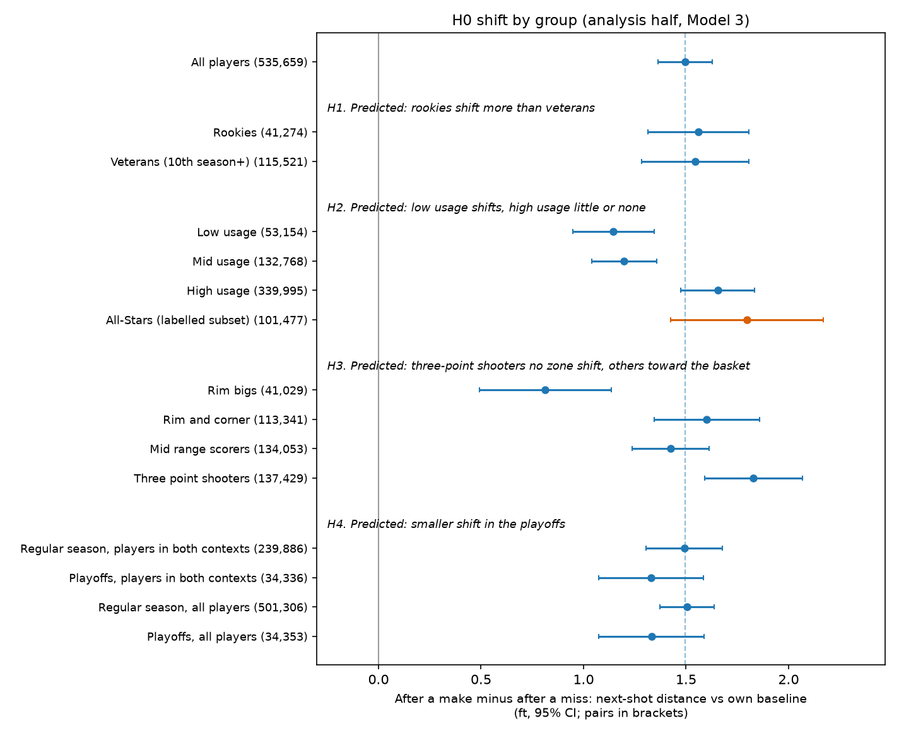

# NBA Shot Selection and the Hot Hand

After a make, NBA players take their next shot on average 1.5 ft (46 cm) farther from the basket
than after a miss (95% interval 1.4 to 1.6 ft). The data shows no hot hand: once shot difficulty and
the sequence bias are accounted for, a player is not more likely to make his next shot after a make.

Dashboard: run it locally with `make dashboard` (public link coming soon).



## Question

After a made or missed shot, how does an NBA player's next shot change in distance, zone and
difficulty compared with that same player's own baseline, and does that change differ by
experience, role, playstyle and season type? Each shot is a decision made under pressure right
after a success or a failure, so the next shot shows how players update and react after receiving
good or bad feedback on their performance.

## Key results

95% intervals in brackets; pp = percentage points.

**Headline:** after a make, the next shot is 1.5 ft farther out than after a miss (1.4 to 1.6 ft),
with 5.4 pp more threes and 5.2 pp fewer rim attempts.

- **H0, partly right:** after a miss the next shot is 0.9 ft closer (+3.2 pp at the rim). After a
  make it is 0.6 ft farther (+2.4 pp threes), so players move out after a make instead of staying put.
- **H1, wrong (no difference):** rookies shift 1.56 ft and veterans 1.55 ft. The gap is +0.07 ft
  (-0.28 to +0.41), Holm p = 0.95.
- **H2, wrong (opposite direction):** high usage shifts 1.66 ft and low usage 1.15 ft. The gap is
  -0.47 ft (-0.73 to -0.21), Holm p = 0.001. Explanation to test later: high-usage players are the
  first option, so they get the freedom to take harder, farther shots after a make.
- **H3, partly right:** the shifts differ across playstyles (Holm p = 0.0001). Three-point shooters
  shift the most (1.83 ft, with above-the-break threes -4.4 pp after a miss and +4.2 pp after a make)
  and rim bigs the least (0.81 ft). All four groups take +2.1 to +3.8 pp more rim attempts after a
  miss. Explanation to test later: three-point shooters have the widest range to move across, from
  the rim to the arc.
- **H4, not confirmed (not distinguishable from no difference):** the same players shift 1.33 ft in
  the playoffs and 1.49 ft in the regular season. The gap is -0.08 ft (-0.29 to +0.13), Holm p = 0.95.
- **Hot hand:** once the sequence bias is corrected, the chance of making the next shot after a make
  changes by -0.4 pp (shuffle within game, p = 0.002) or +0.1 pp (shuffle within quarter, p = 0.46):
  no hot hand.

Full results: [docs/hypotheses.md](docs/hypotheses.md#results) · interactive: `make dashboard`

## Data

Eight NBA seasons (2018-19 to 2025-26), regular season and playoffs: 1,804,934 field-goal attempts,
of which 8 were dropped because the two sources named different shooters. They form 1,071,022 pairs
of consecutive shots; games were split at random into two halves, and every test uses the 535,659
pairs of the analysis half. Shots and play-by-play data come from NBA.com, via the nba_api package and the shufinskiy/nba_data bulk dataset. All-Star rosters come from Wikipedia. Raw data is not redistributed. This project is not affiliated with or endorsed by the NBA.

Data source: [NBA.com Stats](https://www.nba.com/stats), accessed through [nba_api](https://github.com/swar/nba_api) and the [shufinskiy/nba_data](https://github.com/shufinskiy/nba_data) bulk dataset. This is a personal, non-commercial research project; the NBA statistics are used only for non-commercial analysis, in line with the NBA.com Terms of Use.

## Method

The data cover 8 seasons (2018-19 to 2025-26), regular season and playoffs, about 1.8 million shots. A pair is two consecutive shots by the same player in the same game, at most 4 minutes of game clock apart. Putbacks, tips, heaves and backcourt shots are left out. Each next shot is compared with that player’s own usual shot. Games were split at random into two halves: one half built the difficulty model and the playstyles, and the other ran every test. The model controls for where the previous shot was taken and how hard it was, the game situation and the player-season. The results were checked with a second model and a shuffle test.

In short sequences of shots, simply comparing shots after a make with shots after a miss gives a biased answer (Miller and Sanjurjo, 2018). To correct for this, the order of each player’s shots within a game was shuffled 1,000 times, and the real result was compared with the shuffled ones.

Every analytical choice is logged with its reason in [docs/decisions.md](docs/decisions.md).

## Pre-registered predictions vs results

The predictions for H0 to H4 were committed on 2026-10-14 (commit `0e843c9`), before any data was
downloaded. Each prediction and its result, including the ones that missed:
[docs/hypotheses.md](docs/hypotheses.md).

## Robustness

Before the checks were run, the result was defined as robust if it stayed positive in every variation and stayed close to the original 1.50 ft size in at least 80% of them. By that rule it was met: the effect was positive in 24 of 24 variations and close to 1.50 ft in 20 of 24. It held when each season was analysed on its own, when special seasons, heaves and garbage time were removed, and when minimum-shot limits were applied. It also held with a different difficulty model, with the two halves of the data swapped, with alternative standard errors, with influential players dropped, and with second-chance possessions removed. The four variations that fell outside the range all changed how close in time two shots had to be to count as consecutive. The shift was larger when shots were close together (about 2.0 ft within 60 seconds) and smaller with no time limit (about 1.2 ft), but it was always positive. A placebo test, which should give zero, returned a small but nonzero +0.07 ft, so some leftover confounding cannot be ruled out and the size of the effect should be read with that limitation in mind. In short, the result is robust in direction, but its size depends on how consecutive shots are defined.

Full table: [data/processed/results_robustness.csv](data/processed/results_robustness.csv) ·
specification curve: [reports/figures/stage7_specification_curve.png](reports/figures/stage7_specification_curve.png)

## Limitations

* There is no defender data, so shot difficulty means location only.
* Free throws do not appear in the shot sequence.
* The study is observational, so it cannot show that a miss causes the shift.
* The size of the shift depends on how close in time two shots must be: about 2.0 ft within 60 seconds and 1.2 ft with no limit.
* The placebo test was small but not zero (+0.07 ft), so some leftover confounding is possible.
* The data cover one league and 8 seasons.

## Reproduce it

Requires Python 3.10+ (developed on 3.13, macOS) and about 2.5 GB of disk (1.4 GB data, 1 GB environment). Run from your own computer:
NBA.com refuses many cloud IP addresses.

```bash
git clone https://github.com/vitalemassimo/nba-shot-selection-hot-hand.git
cd nba-shot-selection-hot-hand
make setup   # create .venv from the pinned lock file (~1 min)
make test    # 38 unit tests (~1 min)
make all     # download raw data, then run Stages 2-8 (~75 min on a laptop)
make dashboard-check   # every number the dashboard shows matches the results tables
make dashboard         # open the dashboard locally
```

`make all` regenerates every table in `data/processed/`, every figure in `reports/figures/` and the
executed notebooks. A cold clone on 2026-10-16 reproduced every results table byte for byte
(decision D-059). Re-downloads are checked against `data/raw/manifest.csv` (row counts and SHA-256
hashes); NBA.com's live endpoints can drift slightly over time.

## Repo structure

```
config.yaml        every tunable value (seasons, thresholds, seed)
data/raw/          downloaded files (not committed); manifest.csv is committed
data/interim/      cleaned shot tables (not committed)
data/processed/    results tables, game split, segment labels, dashboard tables (committed)
docs/              hypotheses (pre-registered), decisions log, data dictionary, ownership
notebooks/         02_audit, 03_features, 04_core_test, 05_segments, 06_robustness
src/hothand/       pipeline code (acquire, clean, pairs, xfg, clusters, core, segtests, robustness)
tests/             unit tests (pair and streak logic, permutation test, possession flag, ...)
dashboard/         Streamlit app, its wording (text.yaml) and the displayed-vs-CSV check
reports/figures/   charts used in the README and the dashboard
```

## References

- Gilovich, T., Vallone, R., and Tversky, A. (1985). The hot hand in basketball: On the misperception
  of random sequences. *Cognitive Psychology*, 17(3), 295-314.
- Miller, J. B., and Sanjurjo, A. (2018). Surprised by the hot hand fallacy? A truth in the law of
  small numbers. *Econometrica*, 86(6), 2019-2047.
- Bocskocsky, A., Ezekowitz, J., and Stein, C. (2014). The hot hand: A new approach to an old
  "fallacy". MIT Sloan Sports Analytics Conference.

## Author

**Massimo Vitale** · Data and Business Analytics at IE University, focused on applied AI and data
science, with a particular interest in healthcare and sports ·
[LinkedIn](https://www.linkedin.com/in/massimo-vitale-8aa09233b/) ·
[GitHub](https://github.com/vitalemassimo)

## License

MIT
